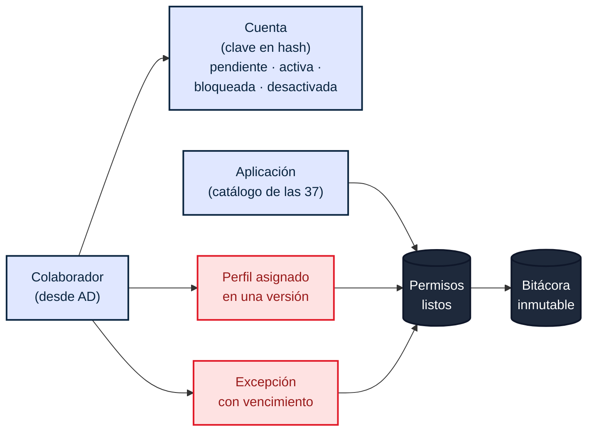

  
Bloque 5 · Datos

  
 Modelo relacional

#  Datos: qué guardamos y qué reglas cumplen

  
<b class="text-brand-red-dark">Cambio de perfil: ¿a todos o a algunos?</b> Cada cambio crea una versión nueva; TI elige a quién aplicarla, en una sola transacción.

  
<b class="text-brand-navy-dark">Clonar copia perfiles, no excepciones</b> Las excepciones son personales y las aprueba otro administrador TI.

  
<b class="text-brand-crimson">Nada cambia sin registro</b> El cambio y su anotación en la bitácora se guardan juntos o no se guarda nada.

  
<b>Base real</b> Partimos del sistema actual; el profesor nos enviará el esquema real para ajustar.

<!--
Guion (Bloque 5):
"El modelo de datos parte del sistema actual, donde a cada persona se le asignan los permisos de cada aplicación uno por uno. Lo que faltaba era el perfil: un paquete de permisos que se asigna de una vez. En simple: el colaborador viene del directorio y tiene una cuenta con su clave guardada de forma irreversible; esa cuenta puede estar pendiente, activa, bloqueada o desactivada. Además tiene perfiles y, si corresponde, excepciones con fecha de término. Con eso, y con el catálogo de las 37 aplicaciones, se calcula la lista de permisos lista para entregar.
Hay tres reglas importantes. Cuando se cambia un perfil se crea una versión nueva, y TI decide si aplicarla a todos o solo a algunos, en una sola transacción, como acordamos con el cliente. Al clonar se copian los perfiles, no las excepciones, que las aprueba otro administrador. Y nada cambia sin quedar registrado. En el informe están el diagrama completo, el diccionario de datos y diez reglas de integridad."
-->

---

  
Bloque 5 · Datos

  
 Modelo no relacional

#  ¿Por qué también Redis?

  

    

 SQL Server (relacional)

    <ul class="space-y-1.5 text-ink/85 leading-relaxed">
      <li><b>Fuente de verdad:</b> todo lo oficial vive aquí.</li>
      <li>Reglas, relaciones e historial completo.</li>
      <li>Responde las consultas de siempre de las 37 apps.</li>
    </ul>
  

  

    

 Redis (no relacional)

    <ul class="space-y-1.5 text-ink/85 leading-relaxed">
      <li>Guarda <b>una ficha lista por persona</b> con sus permisos.</li>
      <li>Se lee de memoria, sin buscar ni cruzar tablas.</li>
      <li>Si cambian los permisos de alguien, <b>se borra su ficha</b> y se rehace en su siguiente consulta.</li>
      <li>Si se borra o se cae, <b>no se pierde nada</b>: se rehace desde SQL.</li>
    </ul>
  

  

~300

usuarios en hora punta

  

~600

consultas simultáneas a la API

  

10 min

duración máxima de cada ficha

  

&lt; 20 ms

meta de respuesta (P95)

 ~300 y ~600: datos del cliente (entrevista 14-11). 10 min: igual que la sincronización con AD. La meta de &lt; 20 ms se medirá en la EVA 3 sobre la infraestructura real.

<!--
Guion (Bloque 5):
"Usamos dos tipos de almacenamiento y cada uno tiene un motivo. SQL Server es la fuente de verdad: ahí están las reglas, las relaciones y el historial. Redis guarda una ficha por persona con sus permisos ya resueltos, lista para entregarla.
¿Por qué no guardar eso también en SQL? Porque las aplicaciones siempre hacen la misma pregunta, qué permisos tiene esta persona, y Redis la responde desde memoria, sin cruzar tablas. Si cambian los permisos de alguien, se borra su ficha y se rehace en su siguiente consulta. Y si Redis se cae, no perdemos nada, porque todo se rehace desde SQL.
Según la entrevista con el cliente, en hora punta trabajan unas 300 personas a la vez y, como cada una usa varias aplicaciones, llegan unas 600 consultas al mismo tiempo. Cada ficha dura máximo 10 minutos, el mismo plazo de la sincronización con el directorio. La meta es responder en menos de 20 milisegundos; la mediremos en la EVA 3 sobre la infraestructura real.
Para que se entienda mejor, preparamos una simulación."
-->

---

  
Bloque 5 · Datos

  
 Simulación

#  Redis en acción

  <SlidevVideo autoplay="once" controls class="w-full rounded-lg">
    <source src="/redis-simulador-corto.mp4" type="video/mp4" />
  </SlidevVideo>

<!--
Guion (Bloque 5) · simulación del diseño, datos de ejemplo:
[0:00] "Una aplicación satélite pide los permisos de un usuario a nuestra API. La API revisa Redis y la ficha ya está lista: responde de inmediato, sin tocar SQL Server."
[0:06] "Ahora llega una consulta por otra persona, pero Redis no tiene su ficha. La API lee sus permisos, que ya están calculados en SQL Server, guarda la ficha en Redis por máximo 10 minutos y responde."
[0:14] "El administrador de TI cambia los permisos de alguien. SQL Server guarda el cambio y su bitácora en una sola transacción, y luego se borra la ficha de esa persona en Redis. En su próxima consulta, la ficha se rehace con los permisos nuevos."
[0:23] "¿Y si Redis no responde? La API lo espera como máximo 50 milisegundos, lee directo desde SQL Server, responde sin errores y avisa a TI con una alerta."
-->
